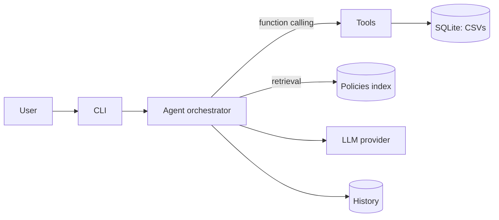

# Empório da Música — Customer Service Agent

A Python text-messaging agent that assists the customer service team of **Empório da
Música**, a fictional musical-instrument store in Campo Grande/MS (Brazil). Built as the
technical case for the **AI Engineer** role at **Artefact (2026)**.

The agent ("Lira") answers questions about the catalog, prices, stock, orders and store
policies, using a **hybrid architecture**: tools/function calling for structured data and
retrieval (RAG) for the policies manual.

---

## ✨ Features

- **Persona** aligned with the store's tone (warm, informal but professional).
- **Catalog & price search** with budget/category filters and active-promotion pricing.
- **Stock awareness** (out-of-stock, discontinued and coming-soon handling).
- **Order status & tracking** by order id or tracking code.
- **Policy answers** (returns, hours, payment, shipping, warranty, privacy) via retrieval —
  bilingual (English/Portuguese) in offline mode.
- **Out-of-scope handling** (politely redirects accessory requests).
- **Conversation history** in memory, with pronoun follow-ups ("Do you have *it* in stock?").
- **Two execution modes:**
  - **LLM mode** — OpenAI-compatible model with function calling (needs an API key).
  - **Offline mode** — deterministic rule-based fallback that uses the same tools, so the
    agent is always runnable and testable without credentials.

---

## 🚀 Quickstart

```bash
# 1. (optional) create a virtual environment
python -m venv .venv && source .venv/bin/activate

# 2. install dependencies
pip install -r requirements.txt

# 3. run the agent (offline mode — no API key required)
python -m src.cli --offline

# single message
python -m src.cli --offline -m "How much is the Takamine GD20?"
```

### LLM mode (DeepSeek)

DeepSeek is OpenAI-compatible, so the same SDK works by pointing the base URL to
`https://api.deepseek.com`.

```bash
cp .env.example .env      # set LLM_API_KEY to your DeepSeek key
pip install -r requirements.txt   # installs the openai SDK
python -m src.cli         # LLM mode is used automatically when a key is set
```

Defaults in `.env.example`: `LLM_PROVIDER=deepseek`, `LLM_MODEL=deepseek-chat`,
`LLM_BASE_URL=https://api.deepseek.com`. `deepseek-chat` supports function calling
(tools); `deepseek-reasoner` does not. Any OpenAI-compatible provider (OpenAI, Groq,
Together, local servers) also works by adjusting these values. If a model call fails,
the agent transparently falls back to offline mode.

> Note: some `openai` builds bundle an httpx variant with a broken gzip decoder
> (`process() takes no keyword arguments`). The agent requests `Accept-Encoding: identity`
> to avoid it, so DeepSeek calls work out of the box.

### Tests

```bash
python -m pytest
```

CI runs lint (`ruff`) and tests (`pytest`) on every push/PR — see
`.github/workflows/ci.yml`.

---

## ☁️ Deploy on Vercel

The project includes a FastAPI app (`src/api.py`) and a Vercel entrypoint
(`api/index.py`). Import the repo in Vercel, set the environment variables in the
dashboard (e.g. `LLM_API_KEY`), and deploy — `vercel.json` configures the Python
runtime and bundles `src/` + `data/`.

Endpoints: `GET /api/health` and `POST /api/chat` (body: `{"message": "..."}`).
See [`docs/deployment.md`](docs/deployment.md) for details and caveats
(serverless conversation sessions are in-memory).

---

## 🧠 How it works



| Component | Responsibility |
|-----------|----------------|
| `src/cli.py` | CLI entry point (interactive or single message). |
| `src/agent/orchestrator.py` | Agent loop, history, LLM function-calling and offline fallback. |
| `src/agent/tools.py` | Tool schemas + implementations (catalog, orders, policies, shipping). |
| `src/agent/prompt.py` | System prompt: persona + hard rules. |
| `src/data/store.py` | Loads the CSVs into an in-memory SQLite database and queries it. |
| `src/data/policies.py` | Extracts the PDF manual and retrieves policy sections. |

**Tools:** `search_products`, `get_product`, `get_order_status`, `query_policies`,
`calc_shipping`, `get_store_info`.

---

## 🧭 Design Decisions (summary)

| Decision | Choice | Why |
|----------|--------|-----|
| Approach | **Function calling + RAG** | Deterministic data via tools; unstructured policies via retrieval. |
| Model | **DeepSeek (default)** via OpenAI-compatible API; configurable | Cheap, fast, supports function calling; swap provider without refactoring. |
| Interface | **CLI** (+ optional API later) | Simplest way to demonstrate the agent working. |
| History | **In-memory** (+ optional SQLite) | Multi-turn context; easy to extend. |
| Data | **SQLite (stdlib)** loaded from CSVs; `pypdf` for policies | Zero extra runtime dependency; fast, deterministic queries. |
| Execution | **Dual mode: LLM + offline fallback** | Always runnable/testable, even without an API key. |

Full rationale: [`docs/technical-decisions.md`](docs/technical-decisions.md).

---

## ⚠️ Known Limitations & Next Steps

- The **offline mode** is intentionally rule-based and covers the main intents; the
  **LLM mode** is the general-purpose path.
- Offline **policy** answers are bilingual (EN/PT); the other offline replies (greeting,
  price, out-of-scope) are currently English-only.
- No persistent storage across processes yet (history is in memory).
- Shipping for other cities is an estimate; real quotes need ZIP/weight/dimensions.
- Next steps: optional FastAPI endpoint, SQLite conversation persistence, embedding-based
  retrieval, and a larger evaluation (golden set + LLM-as-a-judge).

---

## 🤖 Use of AI Code Assistants

This project was built with **GitHub Copilot** (agent mode) as a pair-programmer:

- **Scaffolding & documentation:** the planning docs, skill, and README structure.
- **Implementation:** data layer (SQLite loader + queries), policy retrieval, tools,
  orchestrator (LLM + offline modes) and CLI.
- **Tests:** the `pytest` suite covering the data layer, policies, tools and agent.

All architectural decisions, data interpretation and review were done by the developer;
Copilot accelerated boilerplate, tests and documentation. The `docs/` folder keeps a live
session log of the work.

---

## 🗂️ Documentation

| Document | Content |
|----------|---------|
| [docs/planning.md](docs/planning.md) | Implementation plan + live project state log |
| [docs/data.md](docs/data.md) | Data dictionary and statistics |
| [docs/policies.md](docs/policies.md) | Store policies digest |
| [docs/architecture.md](docs/architecture.md) | Architecture details |
| [docs/technical-decisions.md](docs/technical-decisions.md) | Justified technical decisions |
| [docs/best-practices.md](docs/best-practices.md) | Best practices included |
| [docs/example-interactions.md](docs/example-interactions.md) | Example conversations plan |
| [docs/deployment.md](docs/deployment.md) | Deploying on Vercel |
| [docs/review-findings.md](docs/review-findings.md) | Technical review: additional findings & justifications |
| [examples/](examples/) | 5 example conversations (English) |

## 🧾 Materials

Original challenge materials are in `Desafio Técnico AI Engineer 2026/` (PDF brief, 6 CSVs
and the policies manual).
