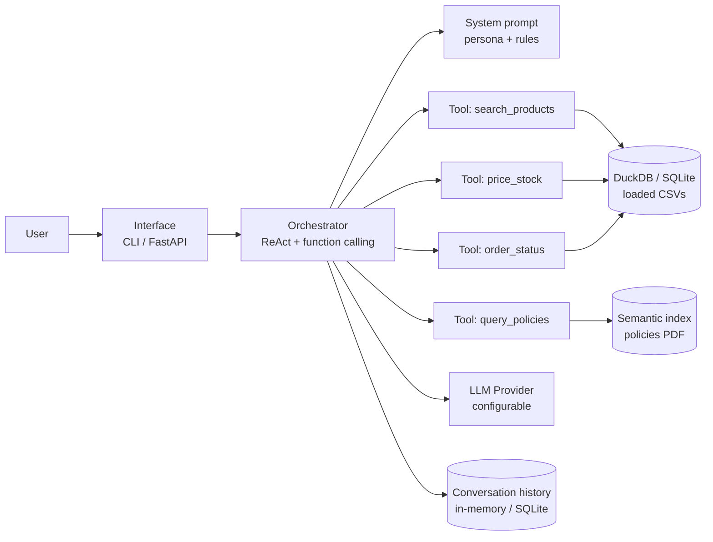
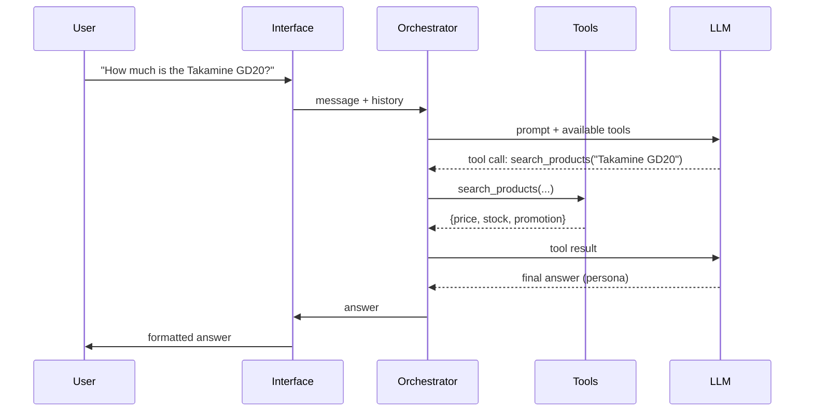

# Proposed Architecture — Customer Service Agent

## 1. Overview

**Hybrid** approach: `function calling` (tools) for structured CSV data and **RAG** for
the unstructured policies PDF. An orchestrator loop decides, each turn, whether to reply
directly, call a tool, or query policies.

## 2. Components

| Component | Responsibility | Suggested tech |
|-----------|----------------|----------------|
| **Interface** | Receive/send messages | CLI (`argparse`/`rich`) + optional FastAPI |
| **Orchestrator** | Agent loop: decide tool vs. reply | ReAct + function calling via provider SDK |
| **System prompt** | Persona, tone, scope and accuracy rules | Versioned template (Jinja2 or f-string) |
| **Tools** | Deterministic data queries | Python + SQL over DuckDB |
| **Data layer** | Load CSVs → DuckDB; extract PDF | `pandas`/`duckdb` + `pypdf` |
| **Policies RAG** | Retrieve relevant manual sections | Chunking + embeddings + search (or BM25 for MVP) |
| **History** | Multi-turn context per customer | In-memory + optional SQLite persistence |
| **Config** | Provider, model, keys, flags | `python-dotenv` + `.env` |

## 3. Message Flow

## 4. Tools (initial contract)

| Tool | Signature | Source |
|------|-----------|--------|
| `search_products` | `(query: str, max_price?: float, category?: str)` → list | `products` + `categories` + `promotions` |
| `price_stock` | `(product_id: int)` → `{price, stock, status, promotion}` | `products` + `promotions` |
| `order_status` | `(order_id: int \| tracking: str)` → status/dates/tracking | `orders` + `order_items` + `products` |
| `query_policies` | `(question: str)` → relevant excerpts | policies PDF RAG index |
| `calc_shipping` | `(city: str, total: float)` → shipping rule | policies (fixed rules) |

## 5. Key Architecture Decisions

1. **DuckDB (embedded, no server):** fast SQL over CSVs without infrastructure.
2. **Tools = Python functions with JSON schema:** allow swapping the LLM provider without
   changing the data logic.
3. **RAG separate from tools:** policies change per document; data changes per query.
   Separation keeps each path testable.
4. **Provider-agnostic:** SDK compatible with the OpenAI API (OpenAI, Groq, Together, etc.).
5. **CLI-first MVP:** quick, demonstrable delivery; API added later with no rework.

## 6. Observability and Quality

- Per-turn logs (tool called, latency, tokens).
- Basic metrics: number of tool calls, tokens/turn, fallback rate.
- Unit tests for tools (deterministic data) and orchestrator tests with a mocked LLM.
