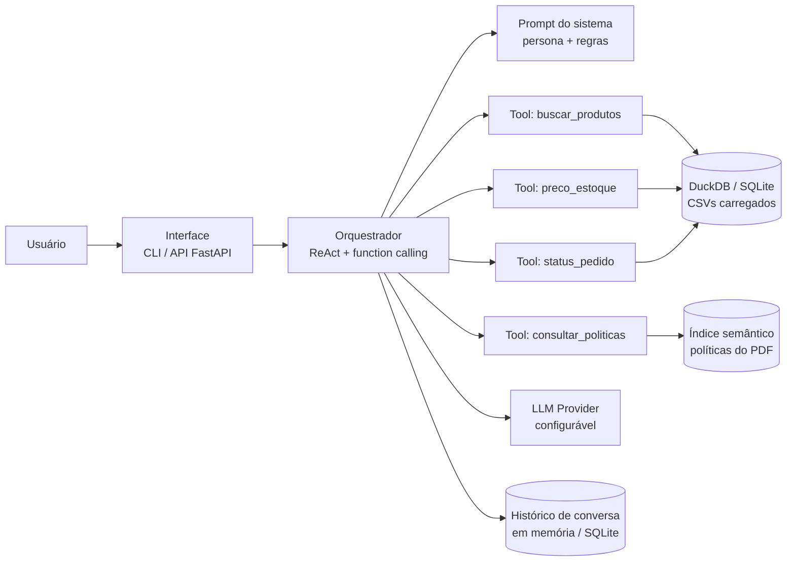
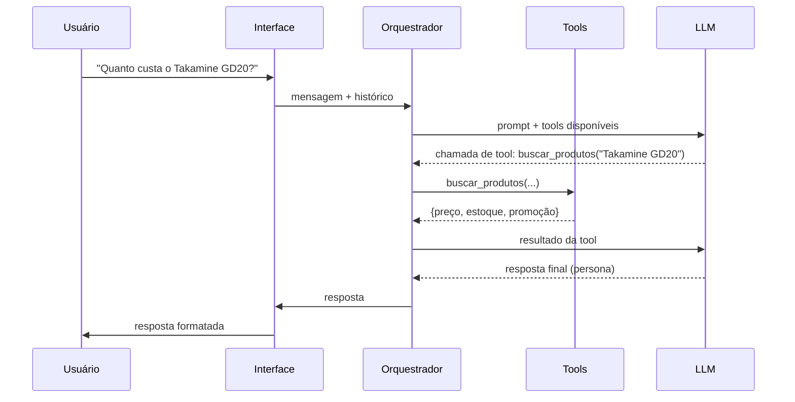

# Arquitetura Proposta — Agente de Atendimento

## 1. Visão Geral

Abordagem **híbrida**: `function calling` (tools) para dados estruturados dos CSVs e
**RAG** para as políticas não estruturadas do PDF. Um orquestrador em loop decide, a
cada turno, se responde direto, chama uma tool ou consulta políticas.

## 2. Componentes

| Componente | Responsabilidade | Tecnologia sugerida |
|------------|------------------|---------------------|
| **Interface** | Receber/enviar mensagens | CLI (`argparse`/`rich`) + API FastAPI (opcional) |
| **Orquestrador** | Loop do agente: decidir tool vs. resposta | ReAct + function calling via SDK do provedor |
| **Prompt do sistema** | Persona, tom, regras de escopo e de precisão | Template versionado (Jinja2 ou f-string) |
| **Tools** | Consultas determinísticas aos dados | Python + SQL sobre DuckDB |
| **Camada de dados** | Load dos CSVs → DuckDB; extração do PDF | `pandas`/`duckdb` + `pypdf` |
| **RAG de políticas** | Recuperar trechos relevantes do manual | Chunking + embeddings + busca (ou BM25 p/ MVP) |
| **Histórico** | Contexto multiturno por cliente | Em memória + persistência SQLite opcional |
| **Config** | Provedor, modelo, chaves, flags | `python-dotenv` + `.env` |

## 3. Fluxo de uma Mensagem

## 4. Tools (contrato inicial)

| Tool | Assinatura | Fonte |
|------|-----------|-------|
| `buscar_produtos` | `(consulta: str, preco_max?: float, categoria?: str)` → lista | `products` + `categories` + `promotions` |
| `preco_estoque` | `(product_id: int)` → `{preço, estoque, status, promoção}` | `products` + `promotions` |
| `status_pedido` | `(order_id: int \| rastreio: str)` → status/datas/rastreio | `orders` + `order_items` + `products` |
| `consultar_politicas` | `(pergunta: str)` → trechos relevantes | índice RAG do PDF |
| `calcular_frete` | `(cidade: str, total: float)` → regra de frete | políticas (regras fixas) |

## 5. Decisões-chave de Arquitetura

1. **DuckDB (embutido, sem servidor):** consultas SQL rápidas sobre os CSVs sem infra.
2. **Tools = funções Python com schema JSON:** permitem trocar o provedor de LLM sem
   mudar a lógica de dados.
3. **RAG separado das tools:** políticas mudam por documento; dados mudam por consulta.
   Separação mantém cada trilha testável.
4. **Provider agnóstico:** SDK compatível com OpenAI API (OpenAI, Groq, Together, etc.).
5. **MVP com CLI:** entrega rápida e demonstrável; API adicionada depois sem retrabalho.

## 6. Observabilidade e Qualidade

- Logs de cada turno (tool chamada, latência, tokens).
- Métricas básicas: nº de tools chamadas, tokens/turno, taxa de fallback.
- Testes unitários das tools (dados determinísticos) e testes do orquestrador com
  LLM mockado.
