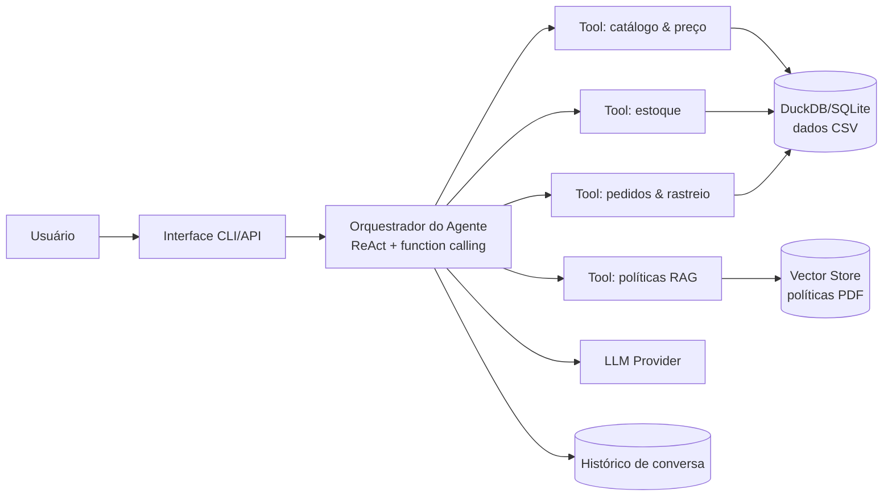

# Plano de Implantação — Agente de Atendimento "Empório da Música"

> **Documento vivo.** Este arquivo é a fonte de verdade do projeto.
> Ao final de **toda sessão de trabalho**, atualize a seção
> [Estado do Projeto](#10-estado-do-projeto) (ver skill `emporio-musica-agent`).

Desafio: **AI Engineer — Artefact (2026)** · Escrito para o caso técnico da Empório da Música.

---

## 1. Contexto e Objetivo

A **Empório da Música** é uma loja fictícia de instrumentos musicais em Campo Grande/MS.
O atendimento hoje é 100% humano e a equipe está sobrecarregada com perguntas recorrentes
(horários, status de pedido, preço e disponibilidade, regras de troca etc.).

**Missão:** prototipar um agente de mensagens de texto em **Python** que auxilie a equipe
no atendimento ao cliente.

### Objetivos do agente

| ID | Objetivo |
|----|----------|
| O1 | Assumir uma **persona** alinhada à identidade e ao tom da loja (informal, mas profissional). |
| O2 | Receber e responder mensagens com base no **contexto disponibilizado**. |
| O3 | Saber **quando consultar dados** (preço, estoque, status de pedido) — nunca "chutar". |
| O4 | Saber **quando consultar políticas** (troca, horários, pagamento, frete). |
| O5 | Lidar adequadamente com perguntas **fora do escopo** da loja. |

---

## 2. Escopo e Requisitos

### Requisitos funcionais (derivados do enunciado)

- **R1 — Persona:** responder no tom da loja (informal, acolhedor, "como um amigo que entende de música").
- **R2 — Contexto:** usar os dados (`data/*.csv`) e as políticas (`políticas_da_loja.pdf`).
- **R3 — Consulta de dados:** preço, disponibilidade, estoque, promoções ativas, status de pedido e rastreio.
- **R4 — Consulta de políticas:** trocas/devoluções, horários, formas de pagamento, frete, garantia.
- **R5 — Fora de escopo:** informar que a loja vende **exclusivamente instrumentos musicais** e redirecionar
  pedidos de acessórios (cordas, cabos, palhetas, pedais, amplificadores, cases).

### Restrição técnica obrigatória

- **Python** como linguagem principal.

### Decisões livres (devem ser justificadas no README final)

| Decisão | Opções possíveis |
|---------|------------------|
| Abordagem do agente | RAG, function calling, ReAct, agente de SQL, híbrido… |
| Modelo e provedor | Pago ou gratuito; local ou via API |
| Interface | CLI, notebook, API ou UI simples |
| Persistência do histórico | Implementar se fizer sentido |
| Tratamento de dados | Livre, conforme necessidade |

---

## 3. Materiais Disponíveis

| Arquivo | Conteúdo | Análise detalhada |
|---------|----------|-------------------|
| `data/*.csv` (6 tabelas) | Produtos, pedidos, itens, clientes, categorias, promoções | [docs/dados.md](dados.md) |
| `data/políticas_da_loja.pdf` | Manual de políticas e procedimentos (v2.1, 8 páginas) | [docs/politicas.md](politicas.md) |

> **Nota:** não é obrigatório usar todos os dados — usar o necessário para a melhor experiência.

---

## 4. Decisões Técnicas Propostas (resumo)

> Detalhamento e justificativas completas em [docs/decisoes_tecnicas.md](decisoes_tecnicas.md).

| Decisão | Proposta | Justificativa curta |
|---------|----------|---------------------|
| Abordagem | **Híbrida: function calling + RAG** | Dados estruturados (CSV) via tools/SQL; políticas não estruturadas (PDF) via retrieval. |
| Modelo/Provedor | **Configurável (OpenAI-compatible)**; default econômico (ex.: `gpt-4o-mini` ou Groq Llama) | Baixo custo, troca fácil de provedor sem refatorar. |
| Interface | **CLI** como MVP + **API FastAPI** opcional | Simples de rodar e demonstrar; API pronta para evoluir. |
| Histórico | **Em memória + persistência SQLite opcional** | Multiturno com contexto por cliente; persistência útil para continuidade. |
| Tratamento de dados | Load dos CSVs para **DuckDB/SQLite**; PDF extraído para índice RAG | Consultas rápidas e determinísticas; políticas semânticas. |

---

## 5. Arquitetura (resumo)

> Diagrama completo e descrição dos componentes em [docs/arquitetura.md](arquitetura.md).



---

## 6. Estrutura do Projeto (proposta)

```
Artefact_Data_Engineer/
├── README.md                       # instruções + decisões + limitações (EN — obrigatório)
├── docs/                           # documentação do projeto
│   ├── planejamento.md             # este arquivo (fonte de verdade)
│   ├── dados.md                    # dicionário de dados
│   ├── politicas.md                # resumo das políticas da loja
│   ├── arquitetura.md              # arquitetura da solução
│   ├── decisoes_tecnicas.md        # decisões técnicas justificadas
│   ├── boas_praticas.md            # boas práticas incluídas
│   └── exemplos_interacoes.md      # planejamento dos exemplos de conversa
├── src/                            # código-fonte do agente (a implementar)
│   ├── agent/                      # orquestrador, prompt, tools
│   ├── data/                       # loaders CSV e extração do PDF
│   ├── tools/                      # funções de consulta (catálogo, pedidos, políticas)
│   └── cli.py                      # ponto de entrada CLI
├── tests/                          # testes automatizados
├── examples/                       # conversas de exemplo (entregável)
├── data/                           # CSVs e PDF fornecidos (referência)
├── requirements.txt                # dependências
├── .env.example                    # modelo de configuração de ambiente
├── Makefile                        # atalhos: install, run, test, lint
└── .github/skills/                 # skill de manutenção do planejamento
```

---

## 7. Fases de Implementação

| Fase | Descrição | Status |
|------|-----------|--------|
| F0 | Análise do desafio, dados e políticas | ✅ Concluída |
| F1 | Documentação de planejamento + boas práticas | 🔄 Em andamento |
| F2 | Scaffold do projeto (estrutura, dependências, env, git) | ⬜ Pendente |
| F3 | Camada de dados (load CSVs → DuckDB; extração PDF) | ⬜ Pendente |
| F4 | Tools do agente (catálogo, estoque, pedidos, políticas) | ⬜ Pendente |
| F5 | Orquestrador + prompt + persona | ⬜ Pendente |
| F6 | CLI e API | ⬜ Pendente |
| F7 | Testes automatizados | ⬜ Pendente |
| F8 | Exemplos de interação (3–5 conversas) | ⬜ Pendente |
| F9 | README final (EN) + revisão + entrega | ⬜ Pendente |

---

## 8. Entregáveis e Checklist

- [ ] **Repositório Git público** no GitHub, com histórico de commits real (sem force-push de tudo em um commit).
- [ ] **README.md (em inglês)** com:
  - [ ] Instruções de execução (ambiente, provedor do modelo, comandos).
  - [ ] Justificativa das decisões técnicas (framework, LLM, retrieval, prompt).
  - [ ] Limitações conhecidas + o que seria feito com mais tempo.
  - [ ] Uso de assistentes de código (qual e como foi usado — workflow).
- [ ] **3 a 5 conversas de exemplo** (`.md`/`.txt`/imagem), incluindo ao menos uma **não trivial**
      (consulta de dados em tempo real ou aplicação de política).
- [ ] **Não alterar** o repositório após o prazo de entrega.

> ⚠️ **Importante:** os entregáveis finais (README e exemplos) devem estar em **inglês**.
> Os documentos internos em `docs/` podem seguir em português.

---

## 9. Boas Práticas Incluídas

Resumo das boas práticas adotadas e documentadas em [docs/boas_praticas.md](boas_praticas.md):

1. Versionamento Git com histórico de commits real.
2. Segredos fora do código (`.env.example` + `.env` ignorado).
3. Ambiente virtual + dependências em `requirements.txt`.
4. Configuração centralizada via variáveis de ambiente.
5. Type hints + docstrings no código Python.
6. Lint e formatação (ruff).
7. Testes automatizados (pytest) com mock do LLM.
8. Logging estruturado.
9. `.editorconfig` para padronização entre editores.
10. `Makefile` para atalhos de tarefas comuns.
11. Documentação viva (este planejamento + skill de manutenção).
12. Privacidade/LGPD e controle de custo de tokens.

---

## 10. Estado do Projeto

> **Regra:** toda sessão deve terminar com uma nova linha neste log.

### Registro de Sessões

| Data | Atividades realizadas | Decisões tomadas | Pendências / próximo passo |
|------|----------------------|------------------|----------------------------|
| 2026-11-03 | Leitura do desafio (PDF), manual de políticas (PDF) e esquema dos 6 CSVs; criação do planejamento, documentação de dados/políticas/arquitetura/decisões/boas práticas, skill de manutenção, README raiz e arquivos de boas práticas | Abordagem híbrida (function calling + RAG); provedor configurável; CLI + API; DuckDB para dados; SQLite para histórico; docs internas em PT e entregáveis em EN | Criar scaffold do projeto Python (F2) e implementar camada de dados (F3) |

### Estado Atual (resumo)

- [x] Análise do desafio e dos materiais
- [x] Documentação de planejamento criada
- [ ] Scaffold do projeto Python (`src/`, `tests/`, `requirements.txt`)
- [ ] Camada de dados (CSV → DuckDB, extração do PDF)
- [ ] Tools do agente
- [ ] Orquestrador e prompt
- [ ] Interface (CLI/API)
- [ ] Testes
- [ ] Exemplos de conversa
- [ ] README final (EN)

---

## 11. Próximo Passo

1. Inicializar o repositório Git (se ainda não feito) e consolidar um commit inicial.
2. Criar o scaffold do projeto: `src/`, `tests/`, `requirements.txt`, `.env.example`.
3. Implementar a camada de dados (Fase F3): carregar CSVs para DuckDB e extrair texto do PDF.
