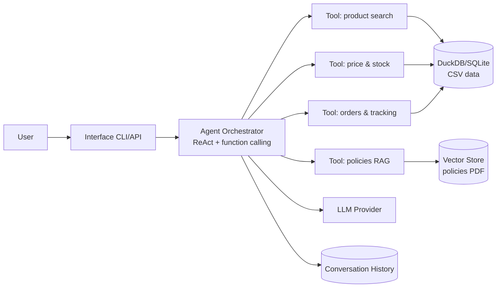

# Implementation Plan — "Empório da Música" Customer Service Agent

> **Living document.** This file is the single source of truth for the project.
> At the end of **every work session**, update the
> [Project State](#10-project-state) section (see the `emporio-musica-agent` skill).

Challenge: **AI Engineer — Artefact (2026)** · Written for the Empório da Música technical case.

---

## 1. Context and Objective

**Empório da Música** is a fictional musical-instruments store in Campo Grande/MS, Brazil.
Customer service is currently 100% human, and the team is overwhelmed by recurring
questions (business hours, order status, price and availability, return rules, etc.).

**Mission:** prototype a **Python** text-messaging agent that assists the team with
customer service.

### Agent objectives

| ID | Objective |
|----|-----------|
| O1 | Assume a **persona** aligned with the store's identity and tone (informal but professional). |
| O2 | Receive and reply to messages based on the **provided context**. |
| O3 | Know **when to query data** (price, stock, order status) — never guess. |
| O4 | Know **when to consult policies** (returns, hours, payment, shipping). |
| O5 | Properly handle questions that are **out of scope** for the store. |

---

## 2. Scope and Requirements

### Functional requirements (derived from the brief)

- **R1 — Persona:** reply in the store's tone (informal, welcoming, "like a friend who knows music").
- **R2 — Context:** use the data (`data/*.csv`) and the policies (`políticas_da_loja.pdf`).
- **R3 — Data queries:** price, availability, stock, active promotions, order status and tracking.
- **R4 — Policy queries:** returns/exchanges, hours, payment methods, shipping, warranty.
- **R5 — Out of scope:** state that the store sells **exclusively musical instruments** and
  politely redirect accessory requests (strings, cables, reeds, pedals, amps, cases).

### Mandatory technical constraint

- **Python** as the primary language.

### Open decisions (must be justified in the final README)

| Decision | Possible options |
|----------|------------------|
| Agent approach | RAG, function calling, ReAct, SQL agent, hybrid… |
| Model and provider | Paid or free; local or API |
| Interaction interface | CLI, notebook, API or simple UI |
| Conversation history persistence | Implement if it makes sense |
| Data handling | Free, as needed |

---

## 3. Available Materials

| File | Content | Detailed analysis |
|------|---------|-------------------|
| `data/*.csv` (6 tables) | Products, orders, items, customers, categories, promotions | [docs/data.md](data.md) |
| `data/políticas_da_loja.pdf` | Policies and procedures manual (v2.1, 8 pages) | [docs/policies.md](policies.md) |

> **Note:** you are not required to use all the data — use what is needed for the best
> customer experience.

---

## 4. Proposed Technical Decisions (summary)

> Full details and justifications in [docs/technical-decisions.md](technical-decisions.md).

| Decision | Proposal | Short rationale |
|----------|----------|-----------------|
| Approach | **Hybrid: function calling + RAG** | Structured data (CSV) via tools/SQL; unstructured policies (PDF) via retrieval. |
| Model/Provider | **Configurable (OpenAI-compatible)**; economical default (e.g. `gpt-4o-mini` or Groq Llama) | Low cost, easy provider swap without refactoring. |
| Interface | **CLI** as MVP + optional **FastAPI** | Simple to run and demo; API ready to evolve. |
| History | **In-memory + optional SQLite persistence** | Multi-turn context per customer; persistence enables continuity. |
| Data handling | Load CSVs into **DuckDB/SQLite**; extract PDF into a RAG index | Fast, deterministic queries; semantic policies. |

---

## 5. Architecture (summary)

> Full diagram and component description in [docs/architecture.md](architecture.md).



---

## 6. Project Structure (proposed)

```
Artefact_Data_Engineer/
├── README.md                       # setup + decisions + limitations (mandatory)
├── docs/                           # project documentation
│   ├── planning.md                 # this file (source of truth)
│   ├── data.md                     # data dictionary
│   ├── policies.md                 # store policies digest
│   ├── architecture.md             # solution architecture
│   ├── technical-decisions.md      # justified technical decisions
│   ├── best-practices.md           # included best practices
│   └── example-interactions.md     # example conversations plan
├── src/                            # agent source code (to be implemented)
│   ├── agent/                      # orchestrator, prompt, tools
│   ├── data/                       # CSV loaders and PDF extraction
│   ├── tools/                      # query functions (catalog, orders, policies)
│   └── cli.py                      # CLI entry point
├── tests/                          # automated tests
├── examples/                       # example conversations (deliverable)
├── data/                           # provided CSVs and PDF (reference)
├── requirements.txt                # dependencies
├── .env.example                    # environment configuration template
├── Makefile                        # shortcuts: install, run, test, lint
└── .github/skills/                 # planning-maintenance skill
```

---

## 7. Implementation Phases

| Phase | Description | Status |
|-------|-------------|--------|
| F0 | Challenge, data and policy analysis | ✅ Done |
| F1 | Planning documentation + best practices | ✅ Done |
| F2 | Project scaffold (structure, dependencies, env, git) | ⬜ Pending |
| F3 | Data layer (CSVs → DuckDB; PDF extraction) | ⬜ Pending |
| F4 | Agent tools (catalog, stock, orders, policies) | ⬜ Pending |
| F5 | Orchestrator + prompt + persona | ⬜ Pending |
| F6 | CLI and API | ⬜ Pending |
| F7 | Automated tests | ⬜ Pending |
| F8 | Example interactions (3–5 conversations) | ⬜ Pending |
| F9 | Final README + review + submission | ⬜ Pending |

---

## 8. Deliverables and Checklist

- [ ] **Public Git repository** on GitHub with a real commit history (no force-pushing everything into a single commit).
- [ ] **README.md** with:
  - [ ] Run instructions (environment, model provider, commands).
  - [ ] Justification of technical decisions (framework, LLM, retrieval, prompt).
  - [ ] Known limitations + what you would do with more time.
  - [ ] Use of code assistants (which one and how it was used — workflow).
- [ ] **3 to 5 example conversations** (`.md`/`.txt`/image), including at least one
      **non-trivial** scenario (real-time data query or policy application).
- [ ] **Do not modify** the repository after the submission deadline.

> ⚠️ **Important:** all responses and deliverables must be in **English**.

---

## 9. Included Best Practices

Summary of the adopted and documented best practices in
[docs/best-practices.md](best-practices.md):

1. Git versioning with a real commit history.
2. Secrets outside the code (`.env.example` + ignored `.env`).
3. Virtual environment + dependencies in `requirements.txt`.
4. Centralized configuration via environment variables.
5. Type hints + docstrings in Python code.
6. Lint and formatting (ruff).
7. Automated tests (pytest) with a mocked LLM.
8. Structured logging.
9. `.editorconfig` for cross-editor consistency.
10. `Makefile` for common task shortcuts.
11. Living documentation (this plan + maintenance skill).
12. Privacy/LGPD and token-cost control.

---

## 10. Project State

> **Rule:** every session must end with a new row in this log.

### Session Log

| Date | Work done | Decisions | Pending / next step |
|------|-----------|-----------|---------------------|
| 2026-11-03 | Read the challenge (PDF), the policies manual (PDF) and the schema of the 6 CSVs; created the plan, the data/policies/architecture/decisions/best-practices docs, the maintenance skill, the root README and the best-practice files | Hybrid approach (function calling + RAG); configurable provider; CLI + API; DuckDB for data; SQLite for history | Create the Python project scaffold (F2) and implement the data layer (F3) |
| 2026-11-03 | Converted all documentation, filenames, and config comments to English | English-only project (docs, filenames, and deliverables) | Create the Python project scaffold (F2) and implement the data layer (F3) |

### Current State (summary)

- [x] Challenge and materials analyzed
- [x] Planning documentation created
- [ ] Python project scaffold (`src/`, `tests/`, `requirements.txt`)
- [ ] Data layer (CSV → DuckDB, PDF extraction)
- [ ] Agent tools
- [ ] Orchestrator and prompt
- [ ] Interface (CLI/API)
- [ ] Tests
- [ ] Example conversations
- [ ] Final README

---

## 11. Next Step

1. Initialize the Git repository (if not already done) and consolidate an initial commit.
2. Create the project scaffold: `src/`, `tests/`, `requirements.txt`, `.env.example`.
3. Implement the data layer (Phase F3): load CSVs into DuckDB and extract the PDF text.
